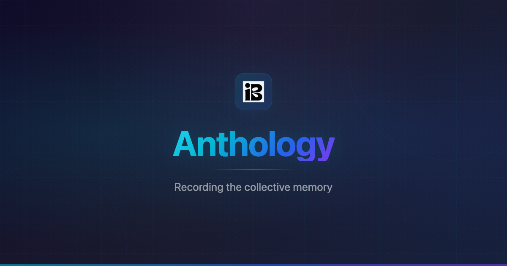

<p align="center">
  <a href="https://memory.inbytes.xyz"></a>
</p>

<p align="center">
  <strong>Local-first knowledge management</strong>
</p>

<p align="center">
  <a href="https://github.com/0xCryptonauta/anthology-fe/releases"></a>
  <a href="#"></a>
  <a href="#"></a>
  <a href="#"></a>
  <a href="#"></a>
  <a href="#"></a>
  <a href="#"></a>
  <a href="#"></a>
</p>

---

## Overview

Anthology lets you collect and share knowledge without depending on a centralized server. Write memoirs — text snippets, URLs, videos, JSON — organize them into collections, and optionally publish them to the Arbitrum blockchain for permanent storage. Or don't. The app works fully offline first.

**Who it's for**: Anyone who keeps notes, curates links, builds playlists, or maintains shared knowledge bases. It's equally useful as a personal journal with no blockchain connection as it is as a Web3 content registry.

**Why it was built**: Most knowledge tools are either fully cloud-dependent or fully local. Anthology bridges the gap — local-first by default, blockchain-published when you choose. No account. No server. Your data lives in your browser's localStorage and optionally on-chain.

---

## Features

<table>
<tr>
<td width="50%">

### 🏠 Local-first
Create, edit, and browse memoirs without any network connection. All data persists in localStorage via Redux persist. The local simulation mirrors the on-chain data model — migrate anytime.

</td>
<td width="50%">

### 📱 Progressive Web App
Install as a standalone app on desktop and mobile. Works offline via Workbox service worker caching. Share content from any app directly into an anthology via the PWA share target API.

</td>
</tr>
<tr>
<td>

### 📡 Offline support
Every blockchain read is cached (5-min TTL). Factory state, anthology metadata, and memoir content are local-first even in on-chain mode. The app works identically with or without connectivity.

</td>
<td>

### 🔗 QR sharing
Every anthology generates a QR code. Other users scan it to import it into their Discover view. Two-way discovery without copy-paste. Uses structured JSON payloads for forward compatibility.

</td>
</tr>
<tr>
<td>

### ⛓️ Optional blockchain
Deploy anthologies as smart contracts on Arbitrum for immutable storage. Pay a fee (ETH or ERC-20) or use local mode forever. Switch between local and on-chain seamlessly — same UI, same data model.

</td>
<td>

### 🎨 Extensible skins
Memoirs are plain strings — the rendering is determined by a skin system. Six skins: media (auto-embeds YouTube, Twitter, Instagram), text, JSON, playlist, and expandable list. Add a new skin with one component.

</td>
</tr>
</table>

---

## Architecture

```
┌──────────────────────────────────────────┐
│             Anthology App                │
│  (React + Redux + localStorage)          │
├──────────────────────────────────────────┤
│  Factory (on-chain registry)             │
│  ├── Users (wallet addresses)            │
│  │   └── Anthology Contracts             │
│  │        └── Memoirs                    │
│  │                                       │
│  └── Local Simulation (22-char "addrs")  │
│       └──Users                           │
│           └── Local Anthologies          │
│                └── Memoirs               │
│                                          │
│  Skin System (interpretation layer)      │
│  └── media | text | json | playlist      │
│                                          │
│  Sharing Layer                           │
│  └── QR Code gen/scan + PWA share target │
└──────────────────────────────────────────┘
```

| Concept | Description |
|---|---|
| **Factory** | The on-chain registry. Tracks every user and every deployed anthology. Handles whitelisting, pricing, and deployment. One per network. |
| **Anthology** | A smart contract (or local equivalent) holding a collection of memoirs. Has a title, a skin, optional whitelist, optional buffer (approval workflow), and optional per-memoir pricing. |
| **Memoir** | A content entry with sender, title, content (string), and timestamp. The content string is interpreted by the skin system. |
| **Skin** | A rendering strategy. Determines how memoir content is displayed: as social embeds, plain text, JSON, YouTube playlists, or expandable lists. |
| **Local simulation** | A client-side mirror of the on-chain data model using 22-character "addresses" (distinct from real 42-char Ethereum addresses). All operations work identically to on-chain but never touch the network. |

---

## Design Decisions

<details>
<summary><strong>Local-first architecture</strong></summary>

The app works fully without wallet connection or blockchain. On-chain is an opt-in layer, not a requirement.

**Why**: Not every user wants to pay gas fees. Not every piece of content needs immutability. The local simulation uses the same Redux slices and component tree as on-chain mode — the only difference is whether data comes from localStorage or RPC calls.

**Trade-offs**: Local data is browser-bound (no multi-device sync without manual export/import). No cryptographic provenance for local memoirs.
</details>

<details>
<summary><strong>Redux with full localStorage persistence</strong></summary>

The entire Redux store is persisted to localStorage via `redux-persist` with no whitelist. Every slice automatically persists.

**Why**: Users should never lose data on refresh or tab close. New state fields added to any slice are persisted by default — zero maintenance overhead.

**Alternatives**: IndexedDB (overkill for string-heavy data), selective persistence (friction per new field).
</details>

<details>
<summary><strong>Blockchain as optional persistence</strong></summary>

Smart contracts are deployed on Arbitrum for low gas costs. The Factory pattern means one registry contract manages all anthologies.

**Why**: Arbitrum provides Ethereum security at a fraction of mainnet costs. The Factory pattern avoids per-user setup complexity. The buffer system adds an optional approval workflow for multi-contributor anthologies.

**Trade-offs**: Smart contract upgrades require deploying a new Factory. Contract reads are cached (5-min TTL) to reduce RPC calls.
</details>

<details>
<summary><strong>PWA over native app</strong></summary>

One codebase for all platforms. Offline caching via Workbox. Share target API enables receiving content from other apps. No app store approval. Instant updates.

**Trade-offs**: Limited OS capabilities (no native file system, no background sync).
</details>

<details>
<summary><strong>React Query + Redux boundary</strong></summary>

TanStack Query handles on-chain data fetching (caching, background refresh). Redux manages app state and user data (what's been loaded). Clear boundary: Redux = durable user state, React Query = transient server cache.

**Trade-offs**: Two state management libraries. The boundary is clear but must be taught to new contributors.
</details>

<details>
<summary><strong>QR sharing via structured JSON</strong></summary>

QR codes encode `{ type: "anthology" | "user", address: "0x..." }`. No backend needed for discovery — scan and import directly.

**Trade-offs**: No encryption on QR payloads. Anthology addresses are public on-chain anyway, so this is by design.
</details>

<details>
<summary><strong>String-based content model</strong></summary>

Content is stored as plain strings on-chain. Skins interpret strings client-side. Keeps gas costs low while enabling rich embeds. Adding a content type = adding one component.

**Trade-offs**: Content is unstructured. Skins must gracefully handle unexpected input. URL detection is best-effort regex.
</details>

---

## Tech Stack

| Layer | Technologies |
|---|---|
| **UI** | React 18 &middot; TypeScript 5 &middot; Tailwind CSS 4 &middot; Bootstrap 5 |
| **State** | Redux Toolkit &middot; Redux Persist &middot; TanStack Query v5 |
| **Routing** | React Router DOM v7 |
| **Web3** | wagmi v2 &middot; viem &middot; WalletConnect |
| **PWA** | vite-plugin-pwa &middot; Workbox |
| **QR** | qrcode.react &middot; html5-qrcode |
| **Build** | Vite 6 &middot; bun &middot; ESLint &middot; standard-version |

---

## Getting Started

```bash
bun install
```

### Environment

```env
VITE_WC_PROJECT_ID="your WalletConnect project ID"
VITE_FACTORY_CONTRACT="Factory contract address on Arbitrum"
VITE_FACTORY_RPC="Arbitrum RPC endpoint"
VITE_ENV="development"
```

### Scripts

| Script | Purpose |
|---|---|
| `bun run dev` | Start dev server (LAN-accessible) |
| `bun run build` | Production build → `dist/` |
| `bun run preview` | Preview production build |
| `bun run tsc` | Type-check |
| `bun run lint` | Lint |
| `bun run release` | Bump version + changelog (main only) |
| `bun run pre-release` | Dry-run release |

### Git workflow

Branch naming: `feature/` &middot; `fix/` &middot; `hotfix/` &middot; `docs/` &middot; `chore/`

Commits follow conventional commits (`feat:`, `fix:`, `refactor:`). `feat:` bumps minor, `fix:` bumps patch via `standard-version`.

```bash
git checkout -b feature/my-feature
git commit -m "feat(scope): description"
git checkout dev
git merge --no-ff feature/my-feature
```

---

## Project Structure

```
src/
├── components/     Reusable UI (Anthology, Factory, Layout)
├── contract-functions/  On-chain read/write + retry + caching
├── hooks/          Custom React hooks
├── store/          Redux config + 5 slices
├── styles/         Global CSS + background patterns
├── types/          TypeScript type definitions
├── utils/          Constants, helpers, regex, hashing
└── views/          Route-level page components
```

---

## Roadmap

- [ ] Multi-device sync (export/import or WebRTC-based)
- [ ] Memoir-level QR codes
- [ ] Collaborative anthologies with on-chain approval
- [ ] Encrypted local storage option
- [ ] Custom skin editor
- [ ] ENS name resolution
- [ ] IPFS-backed memoir content for large media

---

## Lessons Learned

**Redux persist without a whitelist is a double-edged sword.** Every new field persists automatically — great for velocity, but accidental large objects bloat localStorage permanently. Be intentional about what goes into Redux.

**React Query and Redux coexist better than expected with a clear boundary.** Redux = durable state (what's loaded). React Query = transient cache (is it fresh). The line holds well.

**The Factory pattern on-chain is worth the centralization.** One known address for all discovery. No need to scan blocks or index events. Immutable post-deployment.

**QR codes are underrated as a P2P sharing mechanism.** No server. No URL shortener. Just scan. The structured JSON format leaves room for future expansion without breaking existing scanners.
